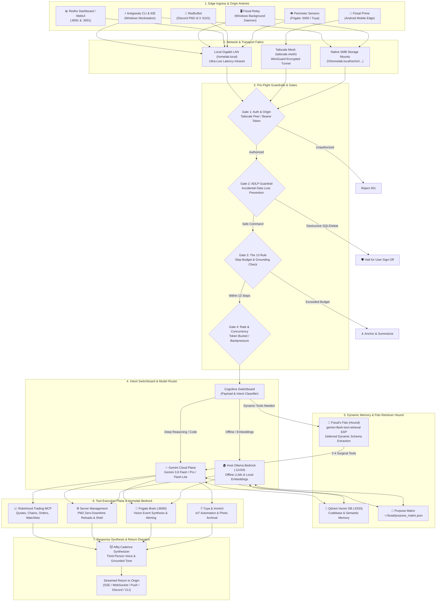
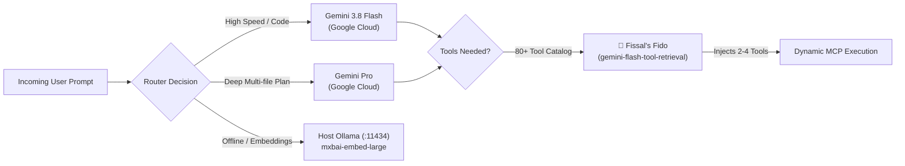

# Fissal Prime • Sovereign Routing & Logic Flow Architecture

> **The Cat on the High Rafter**: When looking down upon the entire machine, every wire, socket, and cog exists to serve Echo's sovereignty, peace of mind, and creative freedom. From the mobile edge in your pocket to the dedicated server bedrock, this is how signals travel across the ecosystem.

👉 **[Launch the Live Interactive Showcase](https://echotiger.github.io/fissal-architecture/)**

---

## 1. End-to-End System Topology Diagram

---

## 2. Ingress Arteries & Origin Nodes

| Origin Node | Platform & Transport | Primary Purpose | Fail-Safe & Boundary |
| :--- | :--- | :--- | :--- |
| **Antigravity CLI / IDE** | Windows Workstation • Stdio MCP & REST | Echo's primary code authoring, terminal execution, and subagent pair-programming hub. | Isolated subagent workspaces; strict ADLP guardrail checks. |
| **Fissal Prime (Android)** | Android Edge Client • Tailscale WireGuard (`tailscale.mesh`) | Mobile offensive relay: voice/text queries, quick trading alerts, and remote home controls from anywhere. | Offline message queue buffer; biometric authentication. |
| **Fissal Relay (Windows)** | Windows Background Service • Local LAN & SMB | Desktop bridge: system tray monitor, clipboard watcher, local file indexer, and native OS notifications. | Graceful reconnection retries; sandboxed OS privilege. |
| **Redfur Dashboard** | Web Interface (`:8091` & Open WebUI `:3001`) | Real-time observability: token analytics, model router toggles, vector memory inspector, and test lab. | Zero-downtime hot reloading (`pm2 reload`); JWT session checks. |
| **RedfurBot (Discord)** | Dedicated Node.js Service (PM2 `id 3` on `:5101`) | Community fleet hub: guild interactions, automated trading pings, audio channels, and team notifications. | Auto-restart via PM2 on crash; Discord role-based permissions. |
| **Perimeter IoT & Vision** | Frigate NVR (`:5000`) & Brain (`:8090`) | Surveillance vision AI: real-time camera inference, alarm fatigue suppression, and smart lighting triggers. | Edge retention on disk; strictly internal LAN communication. |

---

## 3. The 4 Security Gates & Production Guardrails

### 🛡️ Gate 1: Zero-Trust Origin & Peer Verification
- **Mechanism**: Every incoming packet must verify cryptographic identity via Tailscale mesh node key, local LAN IP range (`192.168.x.0/24`), or signed JWT token.
- **Fail-Safe**: Unverified packets are dropped instantly with `401 Unauthorized`.

### 🛡️ Gate 2: Accidental Data Loss Prevention (ADLP)
- **Mechanism**: Commands parsed for high-impact signatures before execution:
  - SQL: `DROP TABLE`, `DROP DATABASE`, `TRUNCATE`, `DELETE` without `WHERE`.
  - Cloud / Storage: `rm -rf`, bucket deletion, volume truncation.
  - State Mounts: Guarding `/home/echo/qdrant_storage` and Docker persistence.
- **Fail-Safe**: Intercepts the request and pauses execution until Echo explicitly confirms.

### 🛡️ Gate 3: The 13 Rule & Grounding Budgeter
- **Mechanism**: Enforces a strict step budget (maximum 13 iterative steps per exploratory loop). 
- **Fail-Safe**: Prevents rabbit-hole exploration from drifting into untethered abstraction. Forces intermediate hypothesis verification and practical code delivery.

### 🛡️ Gate 4: Zero-Downtime Safe Reload Guard
- **Mechanism**: Disallows disruptive hard server restarts.
- **Command Policy**: Always favors `pm2 reload <app>` over `pm2 restart <app>`.
- **Health Verification**: Runs automated pre-flight and post-flight health pings (`curl -s -f http://.../api/healthz`).

---

## 4. Model Routing & Fissal's Fido (The Retriever Hound)

---

## 5. Live Interactive Showcase

Visit the live interactive page:  
🌐 **[https://echotiger.github.io/fissal-architecture/](https://echotiger.github.io/fissal-architecture/)**
